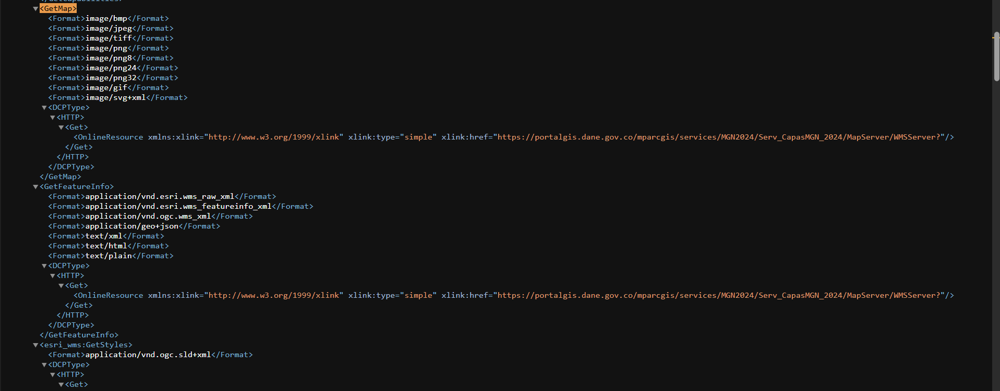
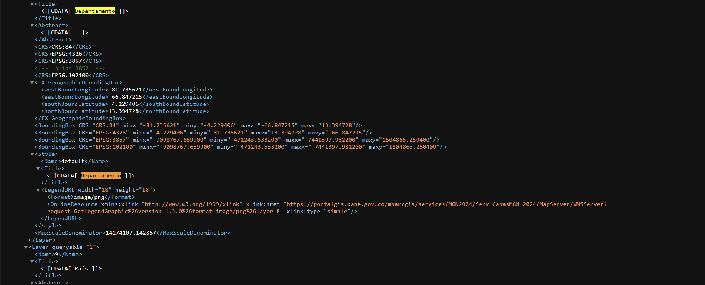
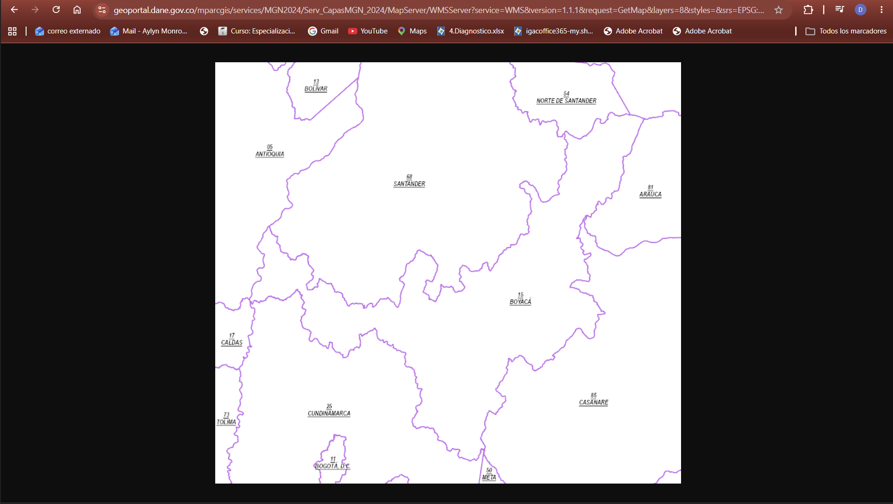
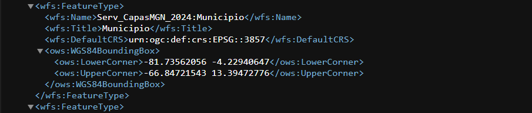
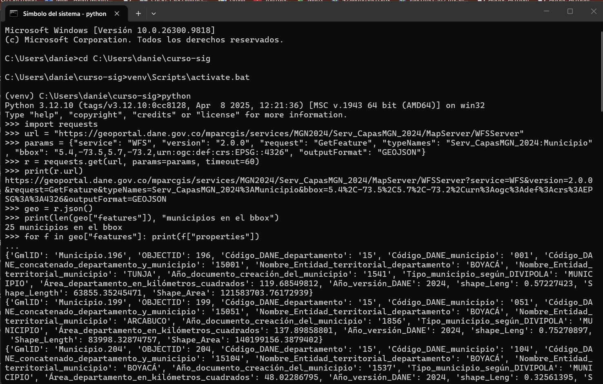
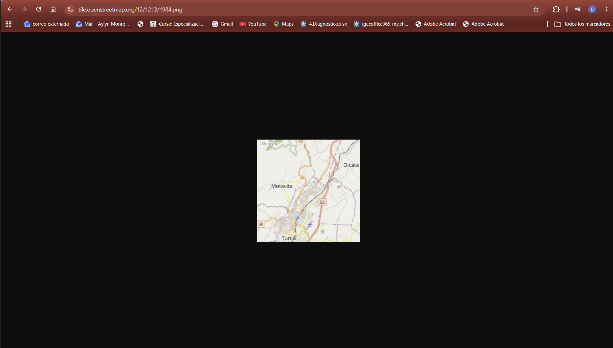

# Operaciones OGC — Capítulo 2

**Autora:** Daniela Monroy
**Servicio principal:** WMS/WFS del DANE, MGN 2024 (`https://geoportal.dane.gov.co/mparcgis/services/MGN2024/Serv_CapasMGN_2024/MapServer`)

## 1. WMS — GetCapabilities

URL:
```
https://geoportal.dane.gov.co/mparcgis/services/MGN2024/Serv_CapasMGN_2024/MapServer/WMSServer?service=WMS&request=GetCapabilities
```

El servicio publica 10 capas (Name 0 a 9), numeradas de la más detallada (0 = Manzana) a la más general (9 = País). Dos de ellas:

| Capa (Title) | Name | CRS soportados | Formatos GetMap |
|---|---|---|---|
| Departamento | 8 | CRS:84, EPSG:4326, EPSG:3857, EPSG:102100 (alias de 3857) | image/png, image/png8, image/png24, image/png32, image/jpeg, image/gif, image/bmp, image/tiff, image/svg+xml |
| País | 9 | CRS:84, EPSG:4326, EPSG:3857, EPSG:102100 (alias de 3857) | los mismos |

Observación: la capa Departamento tiene `MaxScaleDenominator = 14174107`, así que solo se dibuja a escalas mayores que 1:14 millones aproximadamente. Por eso las capas detalladas (como Manzana) salen en blanco si se pide un área grande.





## 2. WMS — GetMap

URL propia (capa 8 = Departamento, bbox que cubre todo Boyacá, imagen 800 x 725 para conservar la proporción):
```
https://geoportal.dane.gov.co/mparcgis/services/MGN2024/Serv_CapasMGN_2024/MapServer/WMSServer?service=WMS&version=1.1.1&request=GetMap&layers=8&styles=&srs=EPSG:4326&bbox=-74.9,4.5,-71.7,7.4&width=800&height=725&format=image/png
```

Con el bbox aproximado de la guía (`-74.5,5.1,-72.0,6.9`) la imagen salía recortada, porque WMS dibuja exactamente el rectángulo pedido. Se amplió el bbox para abarcar todo el departamento.



## 3. WFS — GetFeature filtrado

Petición con filtro espacial (`bbox` alrededor de Tunja) en GeoJSON, hecha con Python (`requests`). En WFS 2.0 con EPSG:4326 el bbox va en orden latitud, longitud:
```
https://geoportal.dane.gov.co/mparcgis/services/MGN2024/Serv_CapasMGN_2024/MapServer/WFSServer?service=WFS&version=2.0.0&request=GetFeature&typeNames=Serv_CapasMGN_2024:Municipio&bbox=5.4,-73.5,5.7,-73.2,urn:ogc:def:crs:EPSG::4326&outputFormat=GEOJSON
```

```python
import requests
url = "https://geoportal.dane.gov.co/mparcgis/services/MGN2024/Serv_CapasMGN_2024/MapServer/WFSServer"
params = {"service": "WFS", "version": "2.0.0", "request": "GetFeature",
          "typeNames": "Serv_CapasMGN_2024:Municipio",
          "bbox": "5.4,-73.5,5.7,-73.2,urn:ogc:def:crs:EPSG::4326",
          "outputFormat": "GEOJSON"}
r = requests.get(url, params=params, timeout=60)
geo = r.json()
print(len(geo["features"]), "municipios en el bbox")
```

**Resultado: 25 municipios**, todos de Boyacá: Tunja, Arcabuco, Boyacá, Chivatá, Ciénega, Cómbita, Cucaita, Chíquiza, Jenesano, Villa de Leyva, Motavita, Nuevo Colón, Oicatá, Ramiriquí, Rondón, Sáchica, Samacá, Siachoque, Sora, Sotaquirá, Soracá, Toca, Tuta, Ventaquemada y Viracachá.

Nombre de la capa en el GetCapabilities del WFS:



Resultado en Python:



## 4. Teselas XYZ

Tesela de OpenStreetMap que contiene a Tunja:
```
https://tile.openstreetmap.org/12/1213/1984.png
```

- **Nivel de zoom (z):** 12
- **Columna (x):** 1213
- **Fila (y):** 1984

La misma zona en otros niveles de la pirámide: `8/75/124` y `10/303/496`. Cada nivel de zoom cuadruplica el número de teselas (2^z × 2^z), por lo que al subir z se ve más detalle de un área más pequeña. En WMTS los equivalentes son TileMatrix (z), TileCol (x) y TileRow (y).


